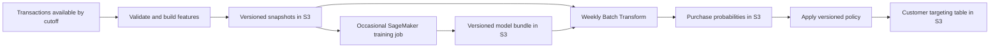

# AWS batch workflow roadmap

## Goal and scope

Build a reproducible weekly scoring workflow around the existing customer
repurchase model. Start locally, then demonstrate one small AWS run:
**S3 → SageMaker Training → model in S3 → Batch Transform → predictions in S3**.

This is a plan, not implemented infrastructure. The historical dataset will be
used to replay scoring dates; it does not provide a live transaction feed.
The selected XGBoost model, threshold 0.62 and existing evaluation remain reference
artifacts. Costs remain illustrative. See [modeling](modeling.md) and [results](results.md).

## Target architecture

Training and weekly inference are separate workflows. Scoring does not retrain.
The policy is separate from probability estimation so its assumptions and threshold
can be versioned without changing the model. Feature generation starts locally;
a later milestone moves it to SageMaker Processing.

## Current status

Local MLflow tracking, artifact imports and development training/evaluation scripts
are implemented, alongside local batch inference, frozen model/policy bundles and
structured scoring logs. The inference Dockerfile and CI workflow are added;
local image build and synthetic container verification pass; see [Docker and CI](containers-ci.md). Fixed-parameter
training reproduction now passes local holdout parity checks; see
[training reproduction](training-reproduction.md). Training container packaging and local parity checks now pass too.
SageMaker training/Batch Transform adapters now pass local contract checks and a
retail replay; see [container contracts](sagemaker-contracts.md). AWS execution remains planned. See [local inference](inference.md).

## Current execution constraints

- Selected local AWS profile: `purchase-propensity`.
- Workload region: `us-east-2` (Ohio).
- Preferred out-of-pocket project spend: **$0**.
- The user confirmed that this account is closed; support recovery is pending.
  Free-tier/credit eligibility has not yet been verified. No cloud resources have
  been created and no managed jobs have been launched by this workflow.

Continue with local Docker and CI while checking account allowances through
read-only access. Before any cloud replay, verify the account's actual plan,
remaining credits, expiry and applicable service/resource limits. Do not assume
that SageMaker, image storage, data storage or logs are free just because the
account has a Free Tier label. Budget alerts alone are not a hard spending cap.
If a zero-charge replay cannot be established, keep the AWS execution optional
and retain the completed local MLOps workflow.

See [AWS Free Tier details](https://aws.amazon.com/free/free-tier-faqs/) and
[account-plan status API](https://docs.aws.amazon.com/aws-cost-management/latest/APIReference/API_freetier_GetAccountPlanState.html).

## Milestones

### 1. Local training and scoring interface — complete locally

Reuse package functions behind commands with explicit input/output paths and
configuration. Notebooks remain exploration and reporting tools.

- Build customer features for a specified cutoff using only earlier transactions.
  Inference needs no future labels; training snapshots still require complete
  50-day outcomes. Validate source coverage at the cutoff.
- Train using fixed selected parameters and explicit fitting populations. First
  reproduce the existing final fit; do not rerun Optuna or select from test.
- Package the fitted preprocessing/model, ordered feature schema, policy and manifest.
- Score a feature table and apply the specified policy separately.

**Current evidence:** the frozen-model scoring replay is implemented and matches
saved probabilities exactly. Fixed-parameter final-fit reproduction also matches
all 28,001 policy-holdout predictions exactly, with the original model and policy preserved.

**Done when:** one local historical replay runs without a notebook; predictions
match the existing model within numerical tolerance; input schema and customer/cutoff
keys are checked; rerunning identical inputs/versions gives equivalent results.
Reproductions write new output locations and preserve the original evaluated bundle.

### 2. Versioning and local experiment tracking

Use manifests with source checksums, code revision, uv lockfile identity, feature
schema, cutoffs, parameters and artifact versions. Local MLflow already links
runs, metrics and artifacts; finish the inference bundle and version contract. Keep credentials and generated data out of Git.

A bundle contains the fitted pipeline, schema, policy configuration and manifest.
The policy records its threshold, costs, model reference and selection population.
MLflow can record the bundle; cloud-hosted tracking is not required for the first run.

**Done when:** a run can be traced from its input data and code to its model,
policy and predictions. The selected bundle is identified explicitly, not by an
unqualified “latest” file.

### 3. Container packaging and automated checks — local targets complete

Create training and inference entrypoints using the existing Python 3.12/uv
environment. Keep prediction dependencies separate from notebook/SHAP tooling
where practical. Adapt serving code to SageMaker's container contract; a pickle
alone is not a Batch Transform deployment. Use ECR for custom AWS container images.

GitHub Actions runs tests, lint and a small inference check before building a
versioned image. Publish images with immutable identifiers such as a commit tag
and record the image digest with each run.

**Done when:** a local container reproduces package-level predictions and the
training/inference contracts pass checks. No cloud jobs are needed yet.

**Current evidence:** separate CLI training/inference targets build and pass local
synthetic checks. Full retail training matches saved holdout probabilities exactly
inside Docker, with MLflow artifacts reloadable on the host. The full CI matrix passed remotely for commit `161b858`. SageMaker job/HTTP adapters now pass local emulation and retail replay checks.
Their new CI job passed remotely for commit `96cdfc2`. Image publishing and ECR remain pending. See [Docker and CI](containers-ci.md).

### 4. First AWS training and batch prediction run

Choose one AWS region, a spending limit and supported CPU instance types before
execution. Configure scoped IAM roles, billing alerts and private S3 storage.

1. Upload a versioned feature dataset and fitting configuration to S3.
2. Run one SageMaker Training job with the selected parameters.
3. Save its model bundle and run metadata to S3.
4. Run Batch Transform on a prepared historical scoring table.
5. Apply the versioned policy and save the customer targeting table.
6. Compare local/cloud outputs and inspect CloudWatch job logs.

Suggested S3 prefixes: `datasets/<version>/`, `models/<version>/`,
`policies/<version>/`, `predictions/<cutoff>/<run-id>/`, `reports/<run-id>/`.
Choose actual bucket names and retention rules during implementation.

**Done when:** one end-to-end replay succeeds, records job/image/model/policy
versions, preserves row identity and matches local predictions. Budget alerts
notify; they are not a guaranteed spending cap. Review completed-job resources
and retained storage after the exercise.

### 5. Managed feature generation and orchestration

Move cleansing, cutoff feature construction and evaluation scripts into SageMaker
Processing. Connect the independently working jobs using SageMaker Pipelines.
Start with manual triggers; add weekly scheduling after rerun behaviour is verified.

**Done when:** scoring runs can be repeated safely for a cutoff, failed jobs are
visible, and the workflow does not silently overwrite approved outputs. Keep
training triggers separate from the weekly scoring schedule.

### 6. Monitoring and release management

Initial drift/missingness reports and gated mature-outcome evaluation now run
locally with the existing Python stack; see [monitoring](monitoring.md). Weekly
aggregation, scheduling, operational notifications and release controls remain
planned. These functions can later run alongside cloud jobs without relying on
a managed monitoring product.

Track source coverage, missingness, feature/score distributions, contact rate and
job failures. Once 50-day outcomes mature, report ranking, calibration and policy
performance by week and customer-history group using our evaluation helpers.

Define model/policy promotion, rollback, retraining triggers and new evaluation
periods. Historical test has already been inspected; do not repeatedly use it for
selection and call it a fresh final evaluation. Weekly snapshots are correlated.

**Done when:** an approved bundle can be identified and rolled back, monitoring
outputs are reproducible, and owners/response rules are documented.

## Output contract

Each scored row records customer ID, cutoff, purchase probability, contact decision,
model version, policy version, feature/data version and scoring run ID. Preserve
customer/cutoff identity through Batch Transform; verify row counts and joins.
Targets and future outcomes are not inference inputs. Invalid or incomplete data
should produce a visible failure rather than silently changing the population.

## Deferred work

FastAPI, Gradio, ALB and a continuously running ECS service are optional later
extensions if interactive scoring is needed. A feature store, distributed training,
GPU workloads and a managed MLflow server are not first-milestone requirements.
Controlled campaign experiments are outside the current implementation scope.

## References

- [Telco reference repository](https://github.com/anesriad/Telco-Customer-Churn-ML): modular code, MLflow, containers and CI/deployment ideas.
- [AWS beginner guide](https://www.marinawyss.com/blog/aws-for-machine-learning-beginners): start with a small storage/training/batch-inference project.
- [SageMaker Training](https://docs.aws.amazon.com/sagemaker/latest/dg/how-it-works-training.html).
- [Batch Transform](https://docs.aws.amazon.com/sagemaker/latest/dg/batch-transform.html).
- [SageMaker Processing](https://docs.aws.amazon.com/sagemaker/latest/dg/processing-job.html).
- [Custom inference containers](https://docs.aws.amazon.com/sagemaker/latest/dg/your-algorithms-inference-code.html).
- [SageMaker Pipelines](https://docs.aws.amazon.com/sagemaker/latest/dg/pipelines.html).
