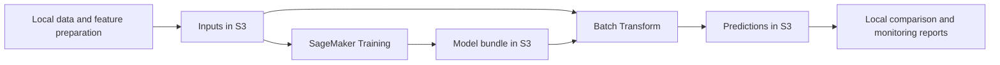

# Small AWS batch replay

## Goal

Demonstrate the existing model workflow once on AWS:

**S3 data → SageMaker Training → model in S3 → Batch Transform → predictions in S3**

Feature preparation remains local. Training uses the selected fixed configuration;
Batch Transform scores a prepared historical customer snapshot table. The model,
threshold **0.62** and original evaluation remain the reference. This is a historical
replay, not a live feed or a new model-selection exercise.

## Current status and cost constraint

Training/inference commands, Docker images and the SageMaker container adapters
are implemented. Local contract checks and a full retail replay pass; see
[SageMaker contracts](sagemaker-contracts.md) and [training reproduction](training-reproduction.md).
Basic logs, drift reports and mature-outcome evaluation also work locally; see
[monitoring](monitoring.md).

The selected AWS profile is `purchase-propensity`, region `us-east-2` (Ohio).
Preferred out-of-pocket spend is **$0**. The user confirmed the account is closed;
account recovery and free-tier/credit eligibility are unresolved. No resources or
managed jobs have been created by this workflow.

Before executing cloud work, verify the account's actual allowances, remaining
credits, expiry and applicable resource limits. Include compute, image/data storage
and logs in the cost check. Budget alerts alone do not guarantee zero charges.
If a zero-charge replay cannot be established, cloud execution stays optional.
The local demonstration remains usable.

## Remaining steps

| Step | Action | Tools |
|---|---|---|
| 1 | Recover account access and verify costs/eligibility | AWS Settings/Basic Support, read-only AWS CLI, billing information |
| 2 | Configure scoped execution permissions, private storage and container images | IAM, S3, ECR, existing Docker images |
| 3 | Upload the processed fitting data and frozen reference artifacts | AWS CLI/SDK, S3, checksum manifests |
| 4 | Run one fixed-parameter training job and save its model bundle | SageMaker Training, existing training adapter |
| 5 | Run one historical prediction batch using prepared JSON Lines features | Batch Transform, existing HTTP adapter |
| 6 | Compare keys/probabilities/decisions, inspect reports/logs and clean up | Existing Python checks/monitoring, CloudWatch job logs, AWS CLI |

Use one CPU instance per job, explicit runtime limits and versioned input/output
locations. Choose instance sizes and actual storage/repository names during setup.
Images and saved artifacts must be identified by immutable versions/digests.
Model artifacts and data remain separate from code-only images.

Suggested S3 prefixes: `datasets/<version>/`, `models/<version>/`,
`predictions/<cutoff>/<run-id>/` and `reports/<run-id>/`.

## Completion criteria

- One training job and one Batch Transform job succeed with identifiable inputs,
  code/image versions, model/policy identities and outputs.
- Customer/cutoff keys and row counts are preserved; predictions match the local
  reference within the fixed tolerance and contact decisions agree.
- Scoring inputs contain only past-derived features, with no target labels.
- Logs and basic monitoring results are inspectable; performance is evaluated only
  after complete 50-day follow-up. Nothing is retuned using the historical test.
- Resources and retained storage are reviewed and cleaned up according to the
  agreed cost constraint. No continuously running endpoint is required.

## Outside this milestone

Processing/Pipelines, EventBridge scheduling, SNS notifications, model-registry
promotion, automatic retraining and automated rollback are optional future work.
The initial demonstration uses manual commands and the existing reports/MLflow
tracking. It does not require a dashboard, interactive API or managed tracking server.

## References

- [Original AWS beginner workflow](https://www.marinawyss.com/blog/aws-for-machine-learning-beginners).
- [Telco repository used as structural inspiration](https://github.com/anesriad/Telco-Customer-Churn-ML).
- [SageMaker Training](https://docs.aws.amazon.com/sagemaker/latest/dg/how-it-works-training.html).
- [Batch Transform](https://docs.aws.amazon.com/sagemaker/latest/dg/batch-transform.html).
- [Custom Batch Transform container contract](https://docs.aws.amazon.com/sagemaker/latest/dg/your-algorithms-batch-code.html).
- [AWS Free Tier](https://aws.amazon.com/free/free-tier-faqs/).
