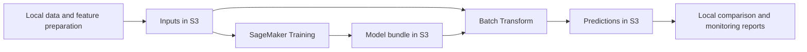

# Small AWS batch replay

## Goal

Demonstrate the existing model workflow once on AWS:

**S3 data → SageMaker Training → model in S3 → Batch Transform → predictions in S3**

Feature preparation remains local. Training uses the selected fixed configuration;
Batch Transform scores a prepared historical customer snapshot table. The model,
threshold **0.62** and original evaluation remain the reference. This is a historical
replay, not a live feed or a new model-selection exercise.



## Current status and cost constraint

Training/inference commands, Docker images and the SageMaker container adapters
are implemented. Local contract checks and a full retail replay pass; see
[SageMaker contracts](sagemaker-contracts.md) and [training reproduction](training-reproduction.md).
The [local demo](demo.md) includes logs, drift reports, mature-outcome evaluation
and an offline dashboard. The request generator was exercised offline, and the
prediction comparison passed on 4,951 predictions from the local SageMaker HTTP
replay. The managed training and transform jobs still need to run on AWS.

The selected AWS profile is `purchase-propensity`, region `us-east-2` (Ohio).
Preferred out-of-pocket spend is **$0**. The user confirmed the account is closed;
account recovery and free-tier/credit eligibility are unresolved. No resources or
managed jobs have been created by this workflow.

Before executing cloud work, verify the account's actual allowances, remaining
credits, expiry and applicable resource limits. Include compute, image/data storage
and logs in the cost check. Budget alerts alone do not guarantee zero charges.
If a zero-charge replay cannot be established, cloud execution stays optional.
The local demonstration remains usable.

## Remaining steps

| Step | Action | Tools |
|---|---|---|
| 1 | Recover account access and verify costs/eligibility | AWS Settings/Basic Support, read-only AWS CLI, billing information |
| 2 | Configure scoped execution permissions, private storage and container images | IAM, S3, ECR, existing Docker images |
| 3 | Upload the processed fitting data and frozen reference artifacts | AWS CLI/SDK, S3, checksum manifests |
| 4 | Run one fixed-parameter training job and save its model bundle | SageMaker Training, existing training adapter |
| 5 | Run one historical prediction batch using prepared JSON Lines features | Batch Transform, existing HTTP adapter |
| 6 | Compare keys/probabilities/decisions, inspect reports/logs and clean up | Existing Python checks/monitoring, CloudWatch job logs, AWS CLI |

Use one CPU instance per job, explicit runtime limits and versioned input/output
locations. Choose instance sizes and actual storage/repository names during setup.
Images and saved artifacts must be identified by immutable versions/digests.
Model artifacts and data remain separate from code-only images.

Suggested S3 prefixes: `datasets/<version>/`, `models/<version>/`,
`predictions/<cutoff>/<run-id>/` and `reports/<run-id>/`.

## Completion criteria

- One training job and one Batch Transform job succeed with identifiable inputs,
  code/image versions, model/policy identities and outputs.
- Customer/cutoff keys and row counts are preserved; predictions match the local
  reference within the fixed tolerance and contact decisions agree.
- Scoring inputs contain only past-derived features, with no target labels.
- Logs and basic monitoring results are inspectable; performance is evaluated only
  after complete 50-day follow-up. Nothing is retuned using the historical test.
- Resources and retained storage are reviewed and cleaned up according to the
  agreed cost constraint. No continuously running endpoint is required.

## Outside this milestone

Processing/Pipelines, EventBridge scheduling, SNS notifications, model-registry
promotion, automatic retraining and automated rollback are optional future work.
The initial demonstration uses manual commands and the existing reports/MLflow
tracking. The local dashboard can present the replay results. Interactive serving and managed tracking are deferred.

## References

- [Original AWS beginner workflow](https://www.marinawyss.com/blog/aws-for-machine-learning-beginners).
- [Telco repository used as structural inspiration](https://github.com/anesriad/Telco-Customer-Churn-ML).
- [SageMaker Training](https://docs.aws.amazon.com/sagemaker/latest/dg/how-it-works-training.html).
- [Batch Transform](https://docs.aws.amazon.com/sagemaker/latest/dg/batch-transform.html).
- [Custom Batch Transform container contract](https://docs.aws.amazon.com/sagemaker/latest/dg/your-algorithms-batch-code.html).
- [AWS Free Tier](https://aws.amazon.com/free/free-tier-faqs/).

## Prepare and run the requests

Generate the three request files locally with the verified bucket, execution role,
CPU instance types and same-region ECR image digests. The image targets are
`sagemaker-training` and `sagemaker-inference`. The generator makes no AWS calls.

```bash
uv run --locked python scripts/aws_replay.py prepare \
  --run retail-replay-001 --bucket "$RETAIL_BUCKET" --role "$RETAIL_ROLE_ARN" \
  --training-image "$RETAIL_TRAIN_IMAGE" --inference-image "$RETAIL_SERVE_IMAGE" \
  --training-instance "$RETAIL_TRAIN_INSTANCE" --transform-instance "$RETAIL_TRANSFORM_INSTANCE" \
  --output artifacts/aws-requests
```

Use the printed S3 prefix and upload only these inputs after account and cost
verification. Use a unique run name for every replay.

| S3 path relative to the printed prefix | Files |
|---|---|
| `input/training/` | `data/processed/refit.parquet` and `data/processed/manifest.json` |
| `input/reference/` | `model.pkl`, `frozen_policy.json` and `policy_predictions.parquet` from `artifacts/final_roc_policy/` |
| `input/batch/features.jsonl` | Export from `scripts/prepare_batch.py` for the verified local cutoff |

For the June 6 replay, generate the batch file locally:

```bash
uv run --locked python scripts/prepare_batch.py \
  --bundle artifacts/demo-2011-06-06/bundle --cutoff 2011-06-06 \
  --coverage-end 2011-12-09 --output artifacts/aws-batch-input
```

The execution role needs access to the input and output prefixes, ECR images and
job logs. The caller needs permission to pass that role. Use the steps below in
order. If a step fails, inspect the job status and logs before continuing.

```bash
aws sagemaker create-training-job --cli-input-json file://artifacts/aws-requests/training.json --profile purchase-propensity --region us-east-2
aws sagemaker wait training-job-completed-or-stopped --training-job-name retail-replay-001-train --profile purchase-propensity --region us-east-2
aws sagemaker describe-training-job --training-job-name retail-replay-001-train --query '{status:TrainingJobStatus,artifact:ModelArtifacts.S3ModelArtifacts}' --profile purchase-propensity --region us-east-2
```

Confirm training status is `Completed` and that the returned model artifact URI
matches the URI in `model.json`. Then create the model record and start the batch.

```bash
aws sagemaker create-model --cli-input-json file://artifacts/aws-requests/model.json --profile purchase-propensity --region us-east-2
aws sagemaker create-transform-job --cli-input-json file://artifacts/aws-requests/transform.json --profile purchase-propensity --region us-east-2
aws sagemaker wait transform-job-completed-or-stopped --transform-job-name retail-replay-001-batch --profile purchase-propensity --region us-east-2
aws sagemaker describe-transform-job --transform-job-name retail-replay-001-batch --query TransformJobStatus --profile purchase-propensity --region us-east-2
```

After a completed transform, download `predictions/features.jsonl.out` and compare it
with the matching local historical replay.

```bash
uv run --locked python scripts/aws_replay.py compare \
  --local artifacts/demo-2011-06-06/batch/scores.parquet \
  --remote artifacts/aws-requests/features.jsonl.out
```

The comparison requires unique matching customer/cutoff keys, matching decisions,
policy, feature and source data versions, and probability agreement within
`1e-7` absolute tolerance. A cloud refit can have a different serialized-model
hash. Record the training artifact and the transform report as lineage.

After retaining the reports you need, delete the SageMaker model record and review
the run-specific S3 objects, ECR images and CloudWatch logs for cleanup. Training
has a 10-minute runtime limit. The transform invocation timeout applies per
request, so monitor the overall job separately and stop it if it exceeds the
agreed time budget. The request files do not create a real-time endpoint.

Request field references are available in the AWS CLI documentation for
[training](https://docs.aws.amazon.com/cli/latest/reference/sagemaker/create-training-job.html),
[model creation](https://docs.aws.amazon.com/cli/latest/reference/sagemaker/create-model.html)
and [batch transform](https://docs.aws.amazon.com/cli/latest/reference/sagemaker/create-transform-job.html).
