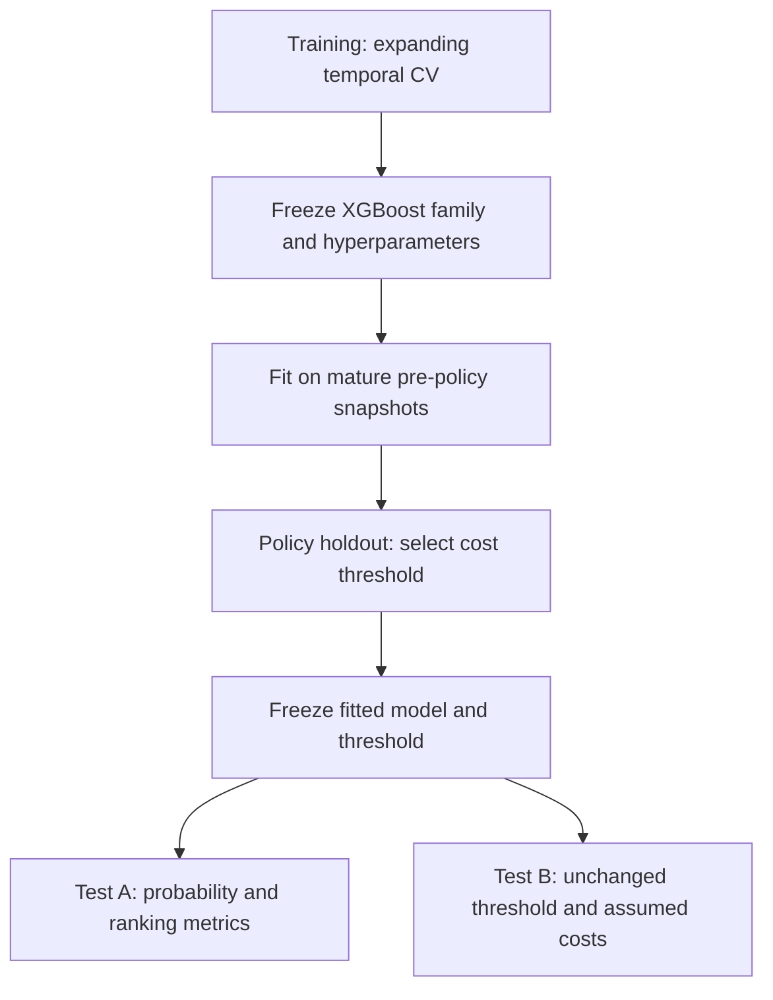

# Modeling and evaluation

The current experiment predicts `RepurchaseWithin50Days`: 1 for a qualifying
purchase in `[cutoff, cutoff + 50 days)`, otherwise 0. Notebook
[04_modeling.ipynb](../notebooks/04_modeling.ipynb) contains the experiments.
See [results and saved model](results.md) for the frozen outcome.

## Models and inputs

| Experiment | Selection method | Outputs under `artifacts/` |
|---|---|---|
| Training-prior reference and L2 logistic, C=1 | Fixed settings | `logistic_baseline/` |
| Elastic-net logistic | Six settings: C=0.01/0.1/1, l1_ratio=0.25/0.75; mean fold weekly log loss | `logistic_elastic_net/` |
| LightGBM, XGBoost, Random Forest | 15 Optuna trials each; mean weekly log loss | `tree_models/` |
| Current tree experiment | 15 Optuna trials each; maximize mean weekly ROC-AUC | `roc_auc_models/` |

A **trial** is one proposed hyperparameter combination. Each Optuna trial fits
three separate models, one per temporal fold. Each tree search experiment therefore
contains 45 trials and 135 fold fits, plus fits of the selected configurations.
Optuna uses sequential TPE sampling, seed 42, five startup trials and no pruning.
The initial search budget is limited; this is not exhaustive optimization.

All classifiers use the same 22 original behavioral/calendar features. IDs, cutoff,
target and five derived RFM columns are excluded. Those RFM columns were fitted
on full training data and must not be reused inside earlier folds. Customer
segments remain descriptive features in the processed datasets, not target classes.

Logistic pipelines fit median imputation, missing indicators, predefined log1p
count/spend transforms and standard scaling. Tree pipelines preserve original
scales and fit median imputation plus missing indicators. Every fold fits its own
preprocessing. Trees use depth/leaf constraints; boosting also searches learning
rate and L1/L2 penalties. No class weights, oversampling or early stopping are used.

## Temporal cross-validation

All rows for a scoring date stay together. Every training snapshot must satisfy
`cutoff + 50 days <= fold validation start`; future outcome windows cannot leak
into the fitting population. Histories themselves use transactions before cutoff.

| Fold | Latest fitting cutoff | Internal validation cutoffs |
|---|---|---|
| 1 | 2010-05-10 | 2010-07-05–2010-07-26 |
| 2 | 2010-06-07 | 2010-08-02–2010-08-30 |
| 3 | 2010-07-12 | 2010-09-06–2010-10-11 |

The current objective averages ROC-AUC across individual validation weeks. Each
week has equal weight, so fold means are weighted by their week counts. Every
week must contain both outcomes. Pooled ROC-AUC and equal-fold summaries are
reported separately and need not equal this objective. Model family selection
uses the highest internal-CV objective, not external validation or test results.

December–March validation compares development models. Repeated weekly snapshots
share customers, histories and outcome windows; they are not independent samples.
Chronological evaluation avoids future-to-past fitting but does not remove this
dependence. Loss gaps may reflect overfitting, changing composition or time drift.

## Calibration diagnostics

Reliability plots use ten quantile bins of purchase probabilities. Each point
compares mean predicted probability with observed purchase fraction in that bin.
A prediction bin averaging 0.7 should have purchases approximately 70% of the time;
the diagonal represents agreement. These plots use development validation data.

No sigmoid, isotonic or other recalibration was fitted. Changing a classification
threshold changes actions, not estimated probabilities. ROC-AUC measures ranking
and does not establish calibrated probabilities; retain log loss and Brier reports.

## Final fitting and policy selection

Selecting a threshold **after refitting** requires a later development holdout:

| Population | Cutoffs | Rows | Purpose |
|---|---|---:|---|
| Final fit | 2010-03-01–2011-01-10 | 146,415 | Fit the selected configuration |
| Policy holdout | 2011-03-07–2011-04-11 | 28,001 | Choose threshold after fitting |
| Final test | 2011-06-06–2011-10-17 | 104,034 | Evaluate frozen model and threshold |

The last six weeks of `refit.parquet` form the policy holdout. Final fitting labels
must mature before its first cutoff. Consequently, the final fit does **not** use
all refit rows: policy weeks and the label-maturity gap are reserved deliberately.
Transactions in excluded scoring weeks remain available as past feature history.
The model stays fixed after policy selection. Policy holdout overlaps earlier
exploratory validation, so its cost is development evidence; test is the final
held-out estimate.

Illustrative costs, in pounds per customer-week:

| Actual outcome | No contact | Contact |
|---|---:|---:|
| No purchase | 0 | 15 |
| Purchase | 25 | 10 |

Contact spends £10. Contacting a non-buyer adds a £5 wasted-contact penalty;
missing a buyer incurs an assumed £25 opportunity cost. These values were proposed
for the experiment, not estimated from transactions. They are decision losses,
not measured incremental campaign ROI. Repeat weekly contacts count separately;
contact suppression and campaign uplift are not modeled.

For threshold t, contact when `p_class_1 >= t`:
`cost = TN*0 + FP*15 + FN*25 + TP*10`.
Search a fixed 0.01 grid from 0 to 1 plus an explicit contact-nobody option. Minimize
mean cost, resolving ties toward fewer contacts and then higher thresholds. Plot
costs on policy data only, with contact-everyone/contact-nobody references.
The selected threshold is **0.62**. Save model and policy before loading test.

## Worked cost example: threshold 0.62

For each customer-week, contact when the predicted probability of purchasing in
50 days is at least the threshold. Compare that action with the observed outcome:

| Actual outcome | No contact | Contact |
|---|---|---|
| No purchase | TN: £0 | FP: £15 |
| Purchase | FN: £25 | TP: £10 |

For any threshold t:

`Cost(t) = 15 × FP(t) + 25 × FN(t) + 10 × TP(t)`.

The frozen threshold **0.62** produces this confusion matrix on test:

| Outcome | Customer-week count | Cost contribution |
|---|---:|---:|
| True negative: no contact, no purchase | 70,929 | £0 |
| False positive: contact, no purchase | 4,919 | £73,785 |
| False negative: no contact, purchase | 16,279 | £406,975 |
| True positive: contact, purchase | 11,907 | £119,070 |
| **Total** | **104,034** | **£599,830** |

Mean cost is `£599,830 / 104,034 = £5.7657`, approximately **£5.77 per
customer-week**. Counts refer to scoring instances; the same person can appear
in several weeks.

An equivalent breakdown separates spending from assumed penalties:

| Component | Calculation | Amount |
|---|---|---:|
| Hypothetical campaign spending | (4,919 FP + 11,907 TP) contacts × £10 | £168,260 |
| Additional wasted-contact penalty | 4,919 FP × £5 | £24,595 |
| Assumed missed-opportunity penalty | 16,279 FN × £25 | £406,975 |
| **Total decision loss** | Sum of these components | **£599,830** |

Only the first component represents campaign expenditure under the assumed £10
contact price. The other components are illustrative penalties. None of these
amounts is observed campaign expenditure, lost revenue or measured profit.

In particular, a false negative is an **uncontacted customer who nevertheless
purchased**. Its £25 penalty does not mean the retailer lost £25. It encodes a
hypothetical preference for reaching buyers. Transaction outcomes alone do not
show whether contact would change a purchase; a controlled campaign experiment
would be needed to estimate incremental response and replace these assumptions
with evidence.

The threshold-cost curve repeats this calculation on the **policy holdout** for
each candidate threshold, then selects minimum mean cost. Threshold 0.62 is frozen
before test evaluation. Its test cost is calculated once without adjusting it.
For comparison, contacting nobody on test gives `28,186 buyers × £25 / 104,034`
= £6.7733 per instance; contacting everybody gives
`(75,848 non-buyers × £15 + 28,186 buyers × £10) / 104,034` = £13.6453.

The F1-selected threshold **0.48** uses the same cost formula, but costs are
calculated **after** maximizing F1 on policy data. Its cost does not determine
its selection. This distinction allows us to compare policies chosen for different
objectives while keeping test outcomes out of the selection process.

## Test reporting and interpretation

Test A reports threshold-agnostic ROC-AUC, average precision, log loss, mean weekly
log loss and binary positive-class Brier score. Average precision summarizes PR
behaviour; it is not trapezoidal PR-AUC. Lower loss/Brier and higher AUC/AP are better.

Test B applies the already selected 0.62 threshold and reports class precision,
recall/F1, confusion counts, contact counts and assumed costs. Separate 0.5
classification diagnostics remain in the JSON report. There is no test threshold
search, calibration fitting or model selection. Showing saved test results again
is evaluation reporting, not a new selection step.

Other development reports include accuracy, balanced accuracy, macro/micro/weighted
precision, recall and F1/F2 (beta=2). Micro precision/recall/F1 equal accuracy in
this single-label task. Balanced accuracy averages class recalls; there is no
separate standard macro/micro accuracy. Zero denominators use zero. Diagnostic
argmax ties go to class 0; the explicit contact policy uses >= threshold.

The final test has now been evaluated. Do not use it to revise this model or policy
and still describe the same results as an untouched final estimate. Future changes
need new later evaluation data or an explicitly redesigned evaluation protocol.
